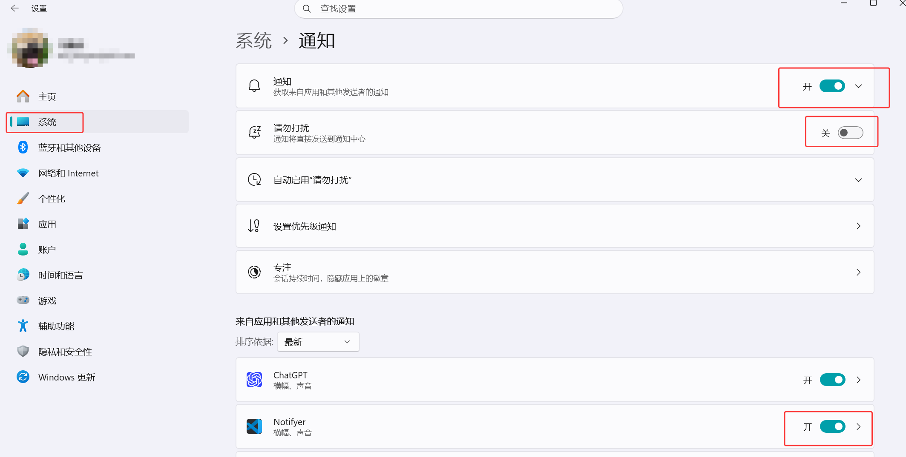

# Notifyer

Language: <a href="https://github.com/mapengsen/Notifyer">English (default)</a> | <a href="https://github.com/mapengsen/Notifyer/blob/main/README.zh-CN.md">简体中文</a>

Notifyer provides Codex and Claude Code main-task notifications, terminal completion notifications, and a Windows desktop floating window summarizing conversations across VS Code windows.

When using AI coding tools such as Codex and Claude Code, have you ever run into this situation?

> You hand code generation to AI, run tests in the terminal, and wait tens of minutes for builds and deployments. You hesitate to step away because you might miss a completed task, a failed test, or an AI waiting for confirmation.

What really consumes time is often not coding itself, but repeatedly switching back to the terminal to check progress. This project is designed to solve that problem. It provides a VS Code extension that lets developers hand long-running tasks to the terminal and AI agents while working on something else; when a task finishes, desktop or VS Code notifications let you know promptly.

**GitHub**: [github.com/mapengsen/Notifyer](https://github.com/mapengsen/Notifyer)

**Plugin**: [marketplace.visualstudio.com/items?itemName=pengsen.codex-task-companion](https://marketplace.visualstudio.com/items?itemName=pengsen.codex-task-companion)

## Features at a glance

| Feature | What Notifyer provides |
| --- | --- |
| Codex and Claude Code | Main-task completion reminders with child-agent filtering. |
| Terminal commands | Success/failure reminders; Python commands by default, with configurable command filtering. |
| Notification delivery | Desktop, VS Code, or both; optional unfocused-window-only delivery and VS Code fallback when desktop delivery fails. |
| Windows floating window | One shared view of running and unread conversations across VS Code windows in the same profile. Click Notifyer in the bottom-right VS Code status bar to show/hide it. |
| Review workflow | Click a card to return to a matching window; mark a result reviewed to remove it. Review state survives restarts. |
| Appearance and controls | Sun/moon theme icons, day by default, with pure black daytime text; desktop notifications off by default; pinning, dragging, collapse and hide. Preferences persist. |
| Local and remote projects | Local UI monitoring with accessible WSL, Remote SSH and container sessions. The floating window appears on the local Windows desktop. |
| Reliability and diagnostics | Silent historical baseline, completion deduplication across windows, helper recovery, test notification and diagnostic commands. |

## Getting started

1. Install or update **Notifyer** from the [VS Code Marketplace](https://marketplace.visualstudio.com/items?itemName=pengsen.codex-task-companion). For a remote project, enable it in the local VS Code UI. Each window to be monitored needs this version enabled in the same profile.
2. After updating, run **Developer: Reload Window** in each open VS Code window. Start a Codex / Claude Code conversation, or run a Python command in an integrated terminal.
3. On Windows, the floating window opens automatically. **Click Notifyer in the bottom-right VS Code status bar to show/hide it**, without opening the command palette. Click the sun/moon icon to change colors. Desktop notifications default to off; enable them with **桌面通知 关** or **Notifyer: Toggle Desktop Notifications** (available on all platforms). Click a conversation card to return to its matching window, and mark completed results reviewed when finished.

| Command palette action | Purpose |
| --- | --- |
| `Notifyer: Toggle Floating Window` | Show/hide the Windows floating window, as with the Notifyer status bar entry. |
| `Notifyer: Show Floating Window` | Open or restore the shared Windows floating window. |
| `Notifyer: Hide Floating Window` | Hide the floating window. |
| `Notifyer: Toggle Desktop Notifications` | Toggle desktop reminders on any platform. Defaults to off; explicit choices persist. |
| `Notifyer: Test Desktop Notification` | Test the configured notification delivery; the desktop switch applies here too. |
| `Notifyer: Show Diagnostics` | Inspect session monitoring, notification delivery and helper health. |
| `Notifyer: Open Settings` | Configure notification channels, session directories and terminal filters. |

**All My Plugin Recommendations:**

1. **Notifyer Plugin**: [marketplace.visualstudio.com/items?itemName=pengsen.codex-task-companion](https://marketplace.visualstudio.com/items?itemName=pengsen.codex-task-companion)
2. **Agent Center**: [marketplace.visualstudio.com/items?itemName=pengsen.codex-claude-agent-status](https://marketplace.visualstudio.com/items?itemName=pengsen.codex-claude-agent-status)

## What can it do?

### 1. Monitor AI coding tasks (desktop notifications)

Notifyer monitors the main-task status of AI agents such as Codex and Claude Code. When a task finishes, the extension sends a desktop notification. Child agents and background processes do not constantly interrupt you, keeping notifications useful.

In WSL, Remote SSH, and container windows, Codex monitoring covers both the connected environment and the local UI environment by default. This allows the same VS Code window to detect tasks written by either remote Codex or local Codex Desktop. Set `codexTaskCompanion.codex.sessionsRoot` only when you want to monitor one explicit directory.

### 2. Monitor terminal commands (desktop notifications)

Notifyer monitors commands running in the terminal and sends a desktop notification when a command succeeds or fails. By default, only Python commands trigger notifications, including `python`, `python3`, `python3.12`, Windows `py`/`pythonw`, and full executable paths such as `/opt/conda/envs/.../bin/python`. Turn off `codexTaskCompanion.terminal.pythonOnly` to restore notifications for every command outside the ignored-command list.

When you click a desktop notification, Notifyer targets the exact VS Code window that produced it. Codex notifications preserve the current editor and layout; terminal notifications additionally reveal the originating terminal.

### 3. Windows floating session window

Running status requires activity observed after startup. A historical scan reconciles the final state silently; it does not turn old unfinished logs into active work. Claude API errors, interruption markers and truncated/terminal response stop reasons hide the running card until real activity resumes. When no explicit stop is logged, the quiet timeout remains a fallback; the 500-minute limit also remains in place. Prompt wording such as “resume after a cut-off” alone is not evidence that a task has stopped.

Drag the header to position the panel; the location saves automatically when you release it. Reopening the panel or restarting VS Code restores that position, including on a secondary monitor. If that display is disconnected or the header is no longer reachable, the panel returns to the nearest available display.

Night colors (sample data):

On Windows, one shared, draggable desktop window opens automatically; no extra desktop runtime is required. Install and enable this version of Notifyer in each VS Code window using the same VS Code profile. Remote SSH, WSL and container windows report sessions accessible to the local UI extension. The panel refreshes approximately every two seconds and shows each conversation's latest turn:

- **Running** with a continuously rotating indicator and elapsed time. Turns exceeding 500 minutes are hidden and excluded from the running count.
- **Completed / error, awaiting review** with a blue dot for results observed after the initial scan. Returning to a window never clears this state. Use **标记已查看** (mark reviewed); acknowledgements synchronize across windows and survive restarts.

The list opens at a fixed height of approximately three conversation cards. Fewer cards leave empty space; additional cards scroll within the list. Only running and unread conversations appear. The 500-minute cutoff applies to the current turn's running time; its later completion can still appear for review, and a new turn is timed separately. Marking a result reviewed immediately removes its card; baseline history is hidden. Disconnected, aborted or quiet conversations are kept as unconfirmed internally and excluded from the running list. Long tools and approval waits can be quiet too; this does not indicate failure.

Drag the header to move the panel. Click the sun/moon icon for day/night colors (day by default, with pure black text), **桌面通知 开 / 关** for shared desktop notifications (off by default), **置顶** to pin it, **− / +** to collapse/expand, and **×** to hide it. All preferences persist, including existing explicit notification choices. Muting desktop notifications preserves session tracking and unread results; explicitly configured VS Code notices remain enabled. **Click Notifyer in the bottom-right VS Code status bar to reopen the window; click again to hide it.** Its eye icon and tooltip track the shared visibility state across VS Code windows. The existing **Notifyer: Show Floating Window** and **Notifyer: Hide Floating Window** commands remain available.

Click anywhere on a conversation card to activate its matching VS Code window, or focus it with Tab and press Enter/Space. Select the conversation within that window. When multiple windows match the same project, a window chooser appears because session logs do not reliably identify the originating window. Marking reviewed does not activate the window. Sessions without a known workspace path and child agents are excluded. The panel currently summarizes Codex / Claude conversations; terminal tasks continue using the existing notifications. The interface currently uses Chinese labels.

Set `codexTaskCompanion.floatingWindow.enabled` to `false` to stop panel collection and hide it. Configure `codexTaskCompanion.floatingWindow.quietAfterMinutes` to adjust the quiet timeout. Existing notifications remain available. State and prompt title excerpts remain in local extension storage; this feature sends no additional data to external services.

Developer checks: `npm run test:unit`; on Windows, run `powershell -NoProfile -ExecutionPolicy Bypass -File scripts/test-floating-panel.ps1` to validate native controls and generate a sample-data preview without opening a desktop window.

If notifications work but the floating window is missing, click **Notifyer in the bottom-right status bar** of the connected VS Code window, or run **Notifyer: Show Floating Window**. After upgrading, run **Developer: Reload Window** once if the entry is missing. The panel appears on the local Windows desktop. Since 0.4.1, helper heartbeats detect unexpected exits and trigger recovery with backoff. For startup failures, run **Notifyer: Show Diagnostics** and inspect `floatingWindow.helperHealthy`, `lastError`, `panelError`, `lastExit`, and **Output → Notifyer Floating Window**.

# If an issue occurs:

Make sure your Windows notifications are enabled and "Do Not Disturb" is turned off.

## Codex and Claude quota display

Starting with 0.3.0, quota display has moved to the independent **Agent Center** extension:

- Agent Center contains only the Codex/Claude quota status bar and no desktop notifications.
- It runs locally for normal workspaces and directly in the connected environment for Remote SSH, WSL, and containers.
- Remote credential reads and quota requests stay entirely on the remote server, with no hidden companion and no token transfer between extensions.

Agent Center: [marketplace.visualstudio.com/items?itemName=pengsen.codex-claude-agent-status](https://marketplace.visualstudio.com/items?itemName=pengsen.codex-claude-agent-status)

# Changelog

## October 22, 2026 (0.4.8)

1. Fix cached running states overriding actual historical completions; reconcile only each file's final state while preserving unread results.
2. Hide baseline-only history until live activity resumes, and recognize Claude API errors, interruptions and truncated responses.
3. Prevent late Codex errors from reviving aborted turns; retain the quiet timeout and 500-minute limit as fallbacks.

## October 22, 2026 (0.4.7)

1. Restore the last panel position on secondary and negative-origin monitors; recover onto the nearest display when the saved position is no longer reachable.
2. Validate position persistence and restoration through native checks.

## October 22, 2026 (0.4.6)

1. Keep the conversation list at a fixed height of approximately three cards, with scrolling for additional conversations.

## October 22, 2026 (0.4.5)

1. Hide running turns exceeding 500 minutes from both the list and running count; later unread completions remain available.
2. Add a continuously rotating indicator before running cards and a blue dot before unread result cards, in both themes.
3. Stop animation clocks when cards are hidden or removed.

## October 22, 2026 (0.4.4)

1. Added a bottom-right Notifyer status bar entry to show/hide the Windows floating window with one click.
2. Eye icons and tooltips reflect shared visibility, including title-bar hiding, rapid clicks and actions from other VS Code windows.
3. Added **Notifyer: Toggle Floating Window**; a missing helper is restarted when opening the panel.

## October 22, 2026 (0.4.3)

1. Replaced text theme labels with sun/moon icons and made daytime text pure black.
2. Desktop notifications now default to off, including missing or invalid preferences; explicit saved choices persist.
3. Added **Notifyer: Toggle Desktop Notifications** on all platforms, so reminders can be enabled without the Windows panel.

## October 22, 2026 (0.4.2)

This release includes the new cross-window desktop monitor introduced in 0.4.0 and the helper recovery fixes from 0.4.1, alongside the following controls and review improvements.

1. Added persistent day/night themes (day by default) and a desktop notification toggle shared across windows.
2. Removed the subtitle and limited the list to running and unread conversations; reviewing a result immediately removes it.
3. Made entire cards activate matching windows, with a chooser for ambiguous matches; removed the separate return button.

## October 22, 2026 (0.4.1)

1. Added floating-helper startup logs, heartbeats and automatic recovery with backoff. Manually hidden windows stay hidden.
2. Fixed Windows snapshot-read sharing so transient replacement failures no longer prevent UI launch.

## October 22, 2026 (0.4.0)

1. Added a shared Windows desktop floating window showing the latest Codex / Claude turns across VS Code windows.
2. Added pinning, dragging, collapsing, hiding/reopening, matching-window activation, and persistent shared review acknowledgements.
3. Added disconnected/quiet status handling and a silent historical baseline for unread results.

## September 15, 2026 (0.3.6)

1. Initial Codex and Claude session scans now establish a strictly silent baseline by default, preventing old completions from being replayed when local and remote clocks differ.
2. Completion events are now claimed atomically in shared extension storage, so opening multiple VS Code windows produces only one notification for the same task.
3. Session files discovered after the initial baseline remain eligible for normal new-task notifications.

## August 24, 2026 (0.3.5)

1. Codex monitoring now watches both local and connected WSL, Remote SSH, or container session directories by default, preventing local Codex Desktop completions from being missed in remote VS Code windows.
2. Windows drive paths and equivalent WSL `/mnt/<drive>` paths now match the same workspace.
3. Notifyer diagnostics now show all monitored Codex session roots and the latest completion-event outcome.

## August 24, 2026 (0.3.4)

1. Updated current README references and plugin recommendations to use the new Agent Center display name while retaining the existing Marketplace extension ID.

## August 24, 2026 (0.3.3)

1. Fixed premature notifications during multi-agent Codex tasks by preserving subagent identity when inherited parent-session metadata appears later in the same JSONL file.
2. Codex session identity now resets correctly when a tracked JSONL file is truncated and rebuilt.

## August 20, 2026 (0.3.2)

1. Fixed desktop notification clicks that failed to restore the originating VS Code window on Windows by recognizing more activation values and adding native focus fallbacks and retries.
2. Notifyer diagnostics now include the latest notification callback and window-focus result.

## August 19, 2026 (0.3.1)

1. Added “All My Plugin Recommendations” to both READMEs and updated the Agent Status Marketplace link.

## August 19, 2026 (0.3.0)

1. Notifyer now focuses on local Codex, Claude, and terminal notifications.
2. Codex and Claude quota display moved to the independent Agent Status extension; the hidden Workspace Companion design was removed.

## August 19, 2026 (0.2.21)

1. Codex and Claude quota items now display an animated refresh indicator while a startup, scheduled, or manual refresh request is running.

## August 19, 2026 (0.2.20)

1. Codex and Claude quotas now refresh immediately at startup, retry every 30 seconds for 3 minutes, and then return to the regular 10-minute default interval.

## August 19, 2026 (0.2.19)

1. Hovering over the Codex or Claude quota item now explains the meaning of the displayed percentage and reset timestamp, identifies the represented quota window, and retains the full per-window details below.

## August 19, 2026 (0.2.18)

1. Codex and Claude quota status items now show the full local reset date and time, for example `5% left | 8-20 11:24` or `5% used | 8-20 11:24`.

## August 19, 2026 (0.2.17)

1. Terminal desktop notifications now monitor only Python commands by default, including full Python executable paths inside Conda environments. The previous behavior can be restored by turning off Python-only mode in settings.
2. Codex and Claude quota status items now use a compact single-line format such as `5% left | 8-20 reset` or `5% used | 8-20 reset`, with reset dates shown as the local month and day.
3. Codex and Claude quota credentials are now isolated by the current VS Code environment. Local Windows, WSL, Remote SSH, and containers use only their own login files, with no cross-environment fallback or other-user directory scanning.

## August 18, 2026 (0.2.16)

1. Clicking a Codex desktop notification now only restores the originating VS Code window and no longer opens a Codex conversation tab automatically.

## August 18, 2026

1. Fixed an issue where clicking a notification with multiple VS Code windows open would only activate the last-used window.
2. Terminal notifications now restore the originating terminal in the correct VS Code window.

## August 18, 2026, 10:10:55

1. Added desktop notifications for all terminal commands except common Linux commands such as `ls`, `ll`, and `pwd`.
2. Clicking a desktop notification now prioritizes the VS Code window that generated it; terminal notifications additionally reveal the corresponding terminal.
