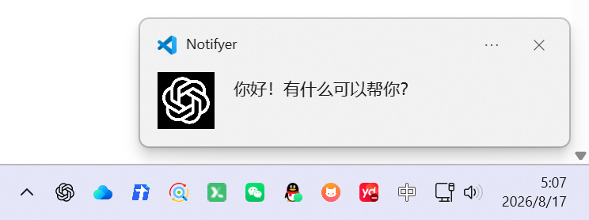
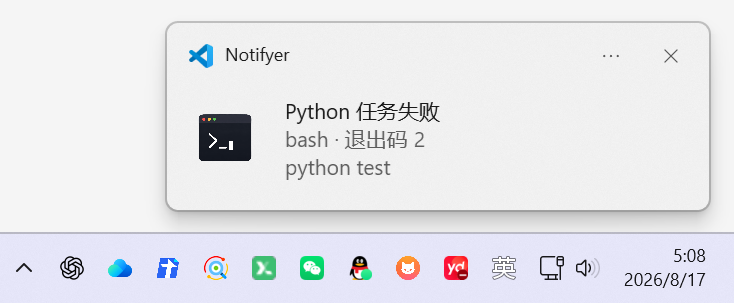
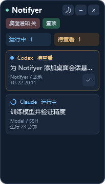
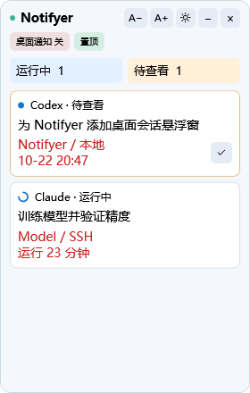

# Notifyer

语言：<a href="./README.md">English（默认）</a> | <a href="./README.zh-CN.md">简体中文</a>

Notifyer 提供 Codex、Claude Code 主任务与 Terminal 命令完成通知，并在 Windows 桌面用悬浮小窗汇总多个 VS Code 窗口的对话状态。

使用 Codex、Claude Code 等 AI 编程工具时，你是否也遇到过这样的场景：

> 代码交给 AI 生成，测试交给终端执行，构建和部署一等就是几十分钟。期间你不敢离开电脑，生怕错过任务完成、测试失败，或者 AI 正在等待你确认。

真正消耗时间的，往往不是编码本身，而是反复切回终端查看进度。这个项目，正是为了解决这个问题而来。它提供了一组 VS Code 插件，让开发者可以把长时间运行的任务交给终端和 AI Agent，自己去处理其他工作；任务完成后，系统会通过桌面通知或 VS Code 通知及时提醒你。

**GitHub**: [github.com/mapengsen/Notifyer](https://github.com/mapengsen/Notifyer)

**Plugin**: [marketplace.visualstudio.com/items?itemName=pengsen.codex-task-companion](https://marketplace.visualstudio.com/items?itemName=pengsen.codex-task-companion)

## 完整项目下载

`main` 分支保存本地 Notifyer 的完整项目，包括 `src/` 源码、`out/` 编译产物、`resources/` 资源、`scripts/` 脚本、`image/` 图片、`.vscode/` 配置、`node_modules/` 依赖、`vsix/` 中的全部历史安装包，以及根目录的配置和说明文件。`.git/` 是 Git 内部版本管理目录，不属于项目内容。

[下载完整项目 ZIP](https://github.com/mapengsen/Notifyer/archive/refs/heads/main.zip)。如果只需安装插件，可以从 [Releases](https://github.com/mapengsen/Notifyer/releases/latest) 下载最新 `.vsix`。仓库中的依赖是当前开发环境的快照，在其他环境中可运行 `npm ci` 重新安装。插件打包范围仍由 `.vscodeignore` 控制。

## 功能一览

| 功能 | 说明 |
| --- | --- |
| Codex / Claude Code | 主任务完成提醒，过滤子 Agent。 |
| 终端命令 | 成功、失败提醒；默认仅 Python，可配置监听其他命令及忽略列表。 |
| 通知方式 | 桌面通知、VS Code 通知或两者；支持仅窗口失焦时提醒，桌面发送失败时回退到 VS Code。 |
| Windows 桌面悬浮窗 | 同一 VS Code 用户配置下，跨窗口汇总运行中与待查看会话；点击 VS Code 底部右侧的 Notifyer 图标显示／隐藏。 |
| 查看流程 | 直接在 VS Code 内选中已完成对话，或点击卡片打开对应会话，确认身份后自动移除该项；仅切回窗口或选中其他对话不清除。也可手动标记，查看状态重启后保留。 |
| 外观与操作 | 太阳／月亮图标切换昼夜配色，默认夜晚；项目名在卡片首行加粗，运行中蓝色、待查看黄色；底部提供方／状态为灰色，比正文小 2 号。桌面通知默认关闭；缩放、置顶、拖动、折叠和隐藏偏好会保存。 |
| 本地与远程项目 | 本机 UI 监听可访问的本地、WSL、Remote SSH 和容器会话；悬浮窗显示在本机 Windows 桌面。 |
| 稳定性与诊断 | 历史扫描静默、多窗口完成通知去重、悬浮窗进程恢复、通知测试与诊断命令。 |

## 开始使用

1. 从 [VS Code 插件市场](https://marketplace.visualstudio.com/items?itemName=pengsen.codex-task-companion) 安装或更新 **Notifyer**。使用远程项目时，在本地 VS Code UI 侧启用；需要监控的各窗口都应在同一用户配置下启用此版本。
2. 更新后，在各个已打开的 VS Code 窗口执行 **Developer: Reload Window**，然后启动 Codex / Claude Code 对话，或在集成终端运行 Python 命令。
3. Windows 悬浮窗启动时默认隐藏并继续后台采集，点击 **VS Code 底部右侧状态栏的 Notifyer 图标**即可显示／隐藏，无需打开命令面板。点击太阳／月亮图标切换配色；桌面通知默认关闭，需要时点击“桌面通知 关”开启，或运行 **Notifyer: Toggle Desktop Notifications**（所有平台可用）。点击会话卡片打开对应对话，确认选中后自动标记已查看；无法确认时保留提醒，也可手动标记。

| 命令面板操作 | 用途 |
| --- | --- |
| `Notifyer: Toggle Floating Window` | 显示／隐藏 Windows 悬浮窗，与状态栏 Notifyer 图标执行相同操作。 |
| `Notifyer: Show Floating Window` | 打开或恢复 Windows 共享悬浮窗。 |
| `Notifyer: Hide Floating Window` | 隐藏悬浮窗。 |
| `Notifyer: Toggle Desktop Notifications` | 开启或关闭桌面通知，所有平台可用；默认关闭，手动选择会保存。 |
| `Notifyer: Test Desktop Notification` | 测试当前通知链路，桌面通知开关也对该测试生效。 |
| `Notifyer: Show Diagnostics` | 查看会话监听、通知发送和悬浮窗进程状态。 |
| `Notifyer: Open Settings` | 配置通知方式、会话目录和终端过滤规则。 |

**我的所有插件推荐：**

1. **Notifyer Plugin**: [marketplace.visualstudio.com/items?itemName=pengsen.codex-task-companion](https://marketplace.visualstudio.com/items?itemName=pengsen.codex-task-companion)
2. **Agent Center**：[marketplace.visualstudio.com/items?itemName=pengsen.codex-claude-agent-status](https://marketplace.visualstudio.com/items?itemName=pengsen.codex-claude-agent-status)

## 它能做什么？

### 1、监听 AI 编程任务（桌面通知）

支持监听 Codex、Claude Code 等 AI Agent 的主任务状态。当任务完成时，插件会自动发送桌面通知；子 Agent 和后台过程不会频繁打扰你，让通知真正有价值。

在 WSL、Remote SSH 和容器窗口中，Codex 监听默认会同时覆盖当前连接环境与本地 UI 环境。因此，同一个 VS Code 窗口既能识别远程 Codex，也能识别本地 Codex Desktop 写入的任务。只有希望仅监听一个指定目录时，才需要设置 `codexTaskCompanion.codex.sessionsRoot`。

支持 `/data/home/user` 等挂载目录中的远程主目录。Codex 按日志最近修改时间发现会话，因此继续旧对话时，即使日志还放在最初创建时的日期目录中，也可以正常识别。非活跃历史不下载，恢复对话不会补发旧完成提醒。Codex 后台服务可能在一轮完成后继续驻留；“运行中”依据实际会话活动判断，不能仅凭进程存在判断。

### 2、Terminal命令监听（桌面通知）

支持监听 Terminal 中运行的命令状态。当命令失败或者成功时，插件会自动发送桌面通知。默认仅通知 Python 命令，包括 `python`、`python3`、`python3.12`、Windows 的 `py`/`pythonw`，以及 `/opt/conda/envs/.../bin/python` 这类完整路径。关闭 `codexTaskCompanion.terminal.pythonOnly` 后，可以恢复监听忽略列表之外的全部命令。

点击桌面通知时，Notifyer 会恢复产生通知的准确 VS Code 窗口。Codex 通知会保留当前编辑器和布局，不再自动打开会话；终端通知会进一步显示原终端。

### 3、Windows 桌面会话悬浮窗

点击顶部“置顶”右侧的 **全部已读**，可一键清除各窗口当前全部已完成／出错的待查看结果，无需逐条点击或切换对话。运行中的任务、待回答的问题和之后新完成的结果会保留；没有待查看结果时，按钮自动禁用。

Codex／Claude 有问题等待你回答时，项目名旁会显示红色加粗的 **有新问题**。悬停查看问题内容，点击卡片打开指定对话；对应问题收到回答或取消后会自动清除，单纯查看对话不会消失。异步问题的“已提交”不算已回答，发起问题的本轮任务结束后仍保留未回答的问题。Codex 中，新的用户轮次替代旧问答后也会清除旧提示，与原生界面保持一致，包括直接输入新要求、没有点击编号回复的情况。按日志轮次／交流标识保留同轮补充和当前问题，系统消息及自动续跑不清除提问；历史重读会静默校正这些状态。问题卡片优先排列，长时间静默等待也不隐藏。新问题的系统桌面提醒遵守原有桌面通知开关；关闭通知仍会保留浮窗中的红色标记。

会话标题会去掉粘贴内容包装标签、图片路径、尺寸、坐标提示等附件标记，只保留可读正文；纯图片／纯附件消息分别显示“图片消息”／“附件消息”。旧缓存也会在显示时清理，不修改原始消息和日志。

点击顶部 **A− / A+** 可立即缩小／放大字号，每次调整一级（范围 10–24 DIP）。默认会话字号从 12 调为 14，标题、加粗项目名、状态文字和计数同步调整，灰色状态行始终比正文小 2 号；字号会保存，重开或重启后恢复。字号按钮与折叠按钮分开。

“运行中”需要启动后观察到真实活动。历史扫描会静默校正最终状态，不会把旧的未完成日志直接当作正在运行。Claude API 连接错误、中断标记及截断等停止状态会退出运行列表，恢复真实活动后再显示。没有明确停止记录时，仍以日志静默超时兜底，并保留 500 分钟显示上限；标题中出现“断流后继续”等字样，本身不作为过滤依据。

Claude 的 `/fast` 等本地设置命令、日志中的本地命令声明及输出不算模型任务，也不会清掉原有待查看结果；浮窗同时过滤旧版残留的 `/fast` 控制命令卡片。真正触发模型工作的斜杠命令仍正常监控。

Claude 等待后台 Agent 或命令时也可能结束一轮中间回复。Notifyer 会跟踪后台任务的启动、结果和通知，已知后台工作结束且主 Agent 完成回复后才显示完成。以用户消息或队列附件形式写入的任务通知仍归属原来的用户任务，保留标题及总运行时长；同一用户轮次最多提醒一次。

默认大小为 280 × 440 DIP（150% 显示缩放下约 420 × 660 像素），默认夜晚配色。卡片首行显示与正文同字号的加粗项目名，运行中蓝色、待查看黄色；中间为单行正文，底部显示灰色的提供方及状态，比正文小 2 号。运行中的灰色状态行末尾追加“已运行 X 分钟”，按当前轮次开始时间计算整分钟，没有新日志时也会继续更新。已完成／出错的待查看结果追加固定总时长，例如“Codex · 待查看 · 共运行 8 分钟”；按本轮开始到结束计算，等待查看及完成后的日志刷新不会继续增加时长。隐藏 SSH 主机信息和时间戳。拖动顶部移动，拖动四边或四角调整大小；大小、位置及手动选择的主题自动保存，再次打开或重启 VS Code 后恢复，副屏也支持。折叠保留展开时的尺寸。原屏幕断开或标题栏不可见时，会自动回到最近的可用屏幕，无需手动保存。

白天配色（示例数据）：

Windows 上的共享悬浮窗默认隐藏启动，点击 VS Code 底部右侧 Notifyer 图标后显示，无需另外安装桌面运行时。隐藏期间继续后台采集；新开其他 VS Code 窗口会保留已手动打开的小窗。每个 VS Code 窗口都需要安装并启用此版本的 Notifyer，使用相同的 VS Code 用户配置；Remote SSH、WSL 或容器窗口仍由本机 UI 扩展采集当前可访问的会话。界面每约 2 秒更新，显示每个对话最新一轮的状态：

- **运行中**：前方显示持续转圈的图标；本轮运行超过 500 分钟后隐藏，同时不计入运行中数量。
- **待查看 / 出错 · 待查看**：前方显示蓝点；点击卡片打开指定对话并确认选中后，该结果自动移除，也可手动点击 **✓**（标记已查看）。只返回窗口不会清除待查看；已查看标记在各窗口之间共享，重启后保留。

默认窗口约容纳 3 张紧凑卡片，可自由调整大小，更多会话滚动查看。会话标题仅一行，超出以省略号显示，悬停可查看保存的标题片段；删除常驻连接说明、跳转说明和重复的 SSH 环境标签。界面保留运行中、待查看及存在待回答问题的会话。500 分钟按当前这一轮的开始时间计算；隐藏后如果收到完成结果，仍会进入待查看，新一轮对话则重新计时。“标记已查看”会立即移除该项；首次扫描的历史完成记录不显示。窗口关闭、扩展断连、任务中止，或运行中超过默认 30 分钟没有新日志的会话会转为待确认，并从运行列表隐藏；长时间工具执行和等待审批也可能暂时没有日志，不代表失败。

拖动顶部移动小窗，太阳／月亮图标切换配色（默认夜晚；白天正文仍为纯黑，项目名按状态着色，底部状态为灰色），“桌面通知 开 / 关”切换所有窗口的桌面提醒（默认关闭），“置顶”切换始终置顶，“− / +”折叠或展开，“×”隐藏。主题、桌面通知开关、位置、置顶及折叠状态会保存；以前手动开启的桌面通知选择会保留。关闭桌面通知仍会继续采集状态并保留待查看结果；若原来配置了 VS Code 内通知，该通道继续生效。隐藏后点击 **VS Code 底部右侧状态栏的 Notifyer 图标**即可重新显示，再点一次隐藏；图标和提示会随真实显隐状态更新，多个窗口之间共享状态。命令面板中的 **Notifyer: Show Floating Window** 与 **Notifyer: Hide Floating Window** 仍可使用。

单击整张会话卡片会返回匹配的 VS Code 窗口，并按会话 ID 打开对应的 Codex／Claude 对话，也可以用 Tab 聚焦后按 Enter 或空格。Codex 会在原有侧边栏聊天界面切换会话，不再新开编辑区标签。确认选中对应对话后，只移除该完成轮次的待查看卡片；仅切换到同一窗口或其他对话不会批量清除。跳转失败、插件不支持指定会话、来源环境不匹配或无法确认选中时，保留待查看，可继续使用勾选按钮手动标记。直接在 VS Code 内选中对应的已完成 Codex／Claude 标签页，也会同步移除该项。Codex 侧边栏通过提供方按会话记录的未读变已读来同步，同时核对已观察到的完成轮次及状态。Claude 编辑器使用保存的会话 ID 与当前标签布局交叉验证，并同步提供方按会话记录的已读变化，覆盖原本已激活的标签页和侧边栏。只返回窗口或选中其他对话不会批量清除；布局、状态或会话身份无法确认时，保留提醒和手动勾选按钮。跳转或验证期间出现的新轮次／新结果仍保留提醒。选择同步仅读取当前 VS Code 的会话身份和提供方已读状态，不修改它们的存储或原始日志。较旧 VS Code 缺少内置只读 SQLite 时，Claude 无法验证的布局继续保留手动标记。同一个项目被多个窗口打开时，会弹出匹配窗口的选择列表；会话日志通常只能关联到项目，不能证明对话属于其中哪个窗口。来源工作目录未知的会话不纳入总览，子 Agent 不显示。点击“标记已查看”不会触发窗口跳转。

设置 `codexTaskCompanion.floatingWindow.enabled` 为 `false` 可以关闭采集和悬浮窗；`codexTaskCompanion.floatingWindow.quietAfterMinutes` 可调整无新日志的判断时间。关闭浮窗不影响原有通知。状态及对话标题片段只保存在本机扩展存储内，不额外发送到外部服务。浮窗当前仅汇总 Codex / Claude 对话，终端仍使用原有完成通知。

开发验证：`npm run test:unit`；Windows 原生界面与按钮验证：`powershell -NoProfile -ExecutionPolicy Bypass -File scripts/test-floating-panel.ps1`，生成使用示例数据的界面截图，不会打开桌面窗口。

如果安装后只有通知而没有小窗，点击连接服务器的 VS Code 窗口底部右侧 **Notifyer 图标**，或运行 **Notifyer: Show Floating Window**；小窗显示在本机 Windows 桌面上。升级后若没有状态栏入口，请先执行一次 **Developer: Reload Window**。0.4.1 起会检测小窗进程心跳并自动恢复意外退出的进程。仍未出现时，运行 **Notifyer: Show Diagnostics** 查看 `floatingWindow.helperHealthy`、`lastError`、`panelError` 与 `lastExit`，以及“输出 → Notifyer Floating Window”中的启动日志。

# 如果出现问题：

确保你的Windows的通知是打开的，请勿打扰是关闭的

## Codex 与 Claude 额度显示

从 0.3.0 开始，额度显示已经迁移到独立插件 **Agent Center**：

- Agent Center 只负责 Codex/Claude 额度状态栏，不包含桌面通知。
- 普通本地窗口中运行在本机；Remote SSH、WSL 或容器窗口中直接运行在对应工作区环境。
- 远程凭据读取和额度请求完全在远程服务器内完成，不需要隐藏 Companion，也不会在扩展之间传递令牌。

Agent Center：[marketplace.visualstudio.com/items?itemName=pengsen.codex-claude-agent-status](https://marketplace.visualstudio.com/items?itemName=pengsen.codex-claude-agent-status)

# 更新日志：

## 2026年10月29日（0.4.28）：

1. 修复新的用户轮次已替代旧问答，Codex 界面不再显示问题，浮窗却仍提示“有新问题”的情况，支持直接输入新要求继续。
2. 按轮次／交流标识静默校正历史，保留当前问题、同轮补充、系统消息、自动续跑和已读状态。

## 2026年10月26日（0.4.27）：

1. 修复 Claude 等待后台 Agent 或命令时提前显示待查看、发送完成提醒的问题。
2. 后台任务通知归属原始用户任务，不再显示内部标记或重置计时，同一用户轮次只提醒一次。

## 2026年10月25日（0.4.26）：

1. 桌面悬浮窗默认隐藏启动，自动恢复也不主动弹出，后台采集继续；点击底部右侧 Notifyer 图标显示。
2. 保留已手动打开的共享小窗，忽略旧显示请求，并响应启动中或重新启用采集时的新点击。

## 2026年10月25日（0.4.25）：

1. 已完成／出错的待查看卡片追加固定总时长，例如“Codex · 待查看 · 共运行 8 分钟”。
2. 按本轮开始到结束计算整分钟，完成后的日志刷新、问题回复及等待查看均不延长时长；兼容旧快照，新轮次重新计时。

## 2026年10月24日（0.4.24）：

1. “置顶”右侧新增 **全部已读**，一键清除各窗口当前全部待查看结果。保留运行任务、待回答问题和之后新完成的结果；没有待查看时按钮自动禁用。

## 2026年10月24日（0.4.23）：

1. Codex／Claude 有待回答的问题时，在项目名旁显示红色加粗“有新问题”，点击卡片打开对应对话。
2. 收到对应回答或取消后自动清除；异步问题已提交、任务本轮完成、只查看对话都不会清掉未回答的问题。
3. 等待中的问题卡片优先显示，长时间静默不隐藏；系统桌面提醒遵守原有桌面通知开关。

## 2026年10月24日（0.4.22）：

1. 修复 Claude 的 `/fast` 等本地命令被计为运行中；识别本地命令日志标记，保留真正的模型任务和原有待查看结果。
2. 过滤旧版本残留的本地控制命令卡片，不屏蔽真正触发模型的斜杠命令。

## 2026年10月23日（0.4.21）：

1. 运行中卡片底部追加“已运行 X 分钟”，例如“Claude · 运行中 · 已运行 23 分钟”；按当前轮次计时，没有新日志时仍自动更新。

## 2026年10月23日（0.4.20）：

1. 点击 Codex 卡片后在原有侧边栏中按会话 ID 打开对应聊天，不再新开编辑区标签，并保留原窗口的 URI 回调。
2. 保留来源检查及具体结果的原生已读核验，链接已发送本身不算已查看。

## 2026年10月23日（0.4.19）：

1. Codex 除编辑区标签选择外，增加侧边栏按会话原生已读变化的同步。
2. 核对具体待查看轮次及状态，不清除其他对话、新结果或无法确认的状态；补充原生已读诊断。

## 2026年10月23日（0.4.18）：

1. 支持 `/data/home/user` 等挂载目录中的 Codex／Claude 远程主目录；Codex 按日志修改时间发现继续使用的旧对话，不受其原始日期目录限制。
2. 历史扫描保持静默；原本不活跃的对话恢复后，仅处理追加活动，避免补发旧完成提醒。

## 2026年10月23日（0.4.17）：

1. 修复本机 Notifyer 无法从本机扩展列表查到远程 Claude／Codex，导致卡片只返回项目窗口的问题；改用全局注册的指定会话选择器。
2. 保留来源与会话 ID 核验，并在窗口诊断中记录实时选中会话及跳转阶段。

## 2026年10月23日（0.4.16）：

1. 补上直接在 VS Code 内选中已完成对话的已查看同步，覆盖原本已激活的 Claude 标签及提供方原生已读变化。
2. 核对会话／轮次、当前标签布局和提供方绑定，不清除其他对话、新结果或无法确认的状态。

## 2026年10月23日（0.4.15）：

1. 项目名移到卡片首行并加粗：运行中蓝色、待查看黄色；提供方及状态移至正文下方，使用灰色，比正文小 2 号。

## 2026年10月23日（0.4.14）：

1. 点击卡片按会话 ID 定位，确认选中后只移除该完成轮次；无法确认或跳转失败时保留提醒，不清除其他对话。

## 2026年10月22日（0.4.13）：

1. 标题先清理粘贴内容及附件标记再截取，原生窗口同时处理旧缓存；纯图片／附件使用简短名称。
2. 新增清理规则共用样例与多模态标题回归验证。

## 2026年10月22日（0.4.12）：

1. 会话下方仅显示项目名，隐藏远程连接后缀、运行时长和时间戳。

## 2026年10月22日（0.4.11）：

1. 默认会话字号由 12 放大至 14，顶部新增 **A− / A+** 按钮，点击立即缩小／放大。
2. 自动保存字号，标题与红色详情同步调整；限制在 10–24 DIP，折叠时为大字留出空间。

## 2026年10月22日（0.4.10）：

1. 默认大小调整为 280 × 440 DIP，默认夜晚配色；保留手动保存的大小、位置和主题。
2. 项目名和运行时间放大至与会话标题相同的字号，并在昼夜配色下使用红色。

## 2026年10月22日（0.4.9）：

1. 默认宽度减半至 205 DIP，顶部按钮紧凑排列，会话标题仅一行，超出显示省略号。
2. 删除常驻连接说明、跳转说明和重复的 SSH 环境标签；以勾选按钮标记已查看。
3. 支持拖动四边和四角缩放，重开、重启及折叠展开时记住大小和位置。

## 2026年10月22日（0.4.8）：

1. 修复运行中缓存覆盖历史完成记录；历史回放仅提交最终状态，并保留已有待查看结果。
2. 纯历史会话等待真实活动后再显示，新增 Claude API 连接错误、中断和截断状态识别。
3. Codex 中止后不会被迟到的错误重新激活；保留静默超时与 500 分钟限制兜底。

## 2026年10月22日（0.4.7）：

1. 修复副屏及负坐标桌面上的位置恢复；保存的位置不可见时，回到最近的可用屏幕。
2. 新增原生位置保存及恢复验证。

## 2026年10月22日（0.4.6）：

1. 中间会话列表默认固定为约 3 张卡片的高度，少量会话保留空白，更多会话滚动查看。

## 2026年10月22日（0.4.5）：

1. 本轮运行超过 500 分钟的会话从列表和运行中计数隐藏；后续完成仍可进入待查看。
2. 运行中卡片前新增持续转圈动画，待查看卡片前新增蓝点，支持白天与夜晚配色。
3. 卡片隐藏或移除时停止动画，避免保留无用动画时钟。

## 2026年10月22日（0.4.4）：

1. 新增 VS Code 底部右侧 Notifyer 状态栏入口，单击显示／隐藏桌面悬浮窗。
2. 眼睛图标及提示随实际显隐状态更新，小窗右上角隐藏、多窗口操作和连续点击保持同步。
3. 新增 **Notifyer: Toggle Floating Window** 命令；悬浮窗进程未运行时，点击入口会尝试恢复。

## 2026年10月22日（0.4.3）：

1. 主题按钮改为太阳／月亮图标，白天文字统一为纯黑。
2. 桌面通知默认关闭，缺失或无效的偏好也默认关闭；保留已手动保存的开关选择。
3. 新增跨平台命令 **Notifyer: Toggle Desktop Notifications**，无需悬浮窗也可切换桌面通知。

## 2026年10月22日（0.4.2）：

本次发布包含 0.4.0 新增的跨窗口桌面监控与 0.4.1 的进程恢复修复，并提供以下外观和查看流程改进。

1. 新增默认白天的昼夜主题按钮，以及跨窗口共享并持久化的桌面通知开关。
2. 删除“会话总览”副标题，列表仅显示运行中和待查看；已查看后立即移除。
3. 整张会话卡片可点击切回窗口，移除“返回窗口”按钮；保留同项目多窗口选择。

## 2026年10月22日（0.4.1）：

1. 新增悬浮窗启动日志、进程心跳与退出后的退避自动恢复；手动隐藏不会触发重新显示。
2. 修复 Windows 原生状态读取阻止文件替换的问题，避免暂时的状态写入错误跳过启动。

## 2026年10月22日（0.4.0）：

1. 新增 Windows 桌面会话悬浮窗，汇总多个 VS Code 窗口中的 Codex / Claude 最新轮次状态。
2. 支持置顶、拖动、折叠、隐藏与恢复、返回匹配窗口和共享的“标记已查看”。
3. 新增断连及日志静默检测；首次历史扫描不产生新的待查看结果。

## 2026年9月15日（0.3.6）：

1. Codex 与 Claude 首次会话扫描现在默认严格静默建立基线，不再因本机与远程服务器时间不一致而补发历史完成通知。
2. 完成事件现在会在插件全局存储中进行原子认领；同时打开多个 VS Code 窗口时，同一个任务只会弹出一次通知。
3. 首次基线建立后才发现的新会话文件仍会正常触发新任务通知。

## 2026年8月24日（0.3.5）：

1. Codex 监听现在默认同时覆盖本地与当前连接的 WSL、Remote SSH 或容器会话目录，避免远程 VS Code 窗口漏掉本地 Codex Desktop 完成事件。
2. Windows 盘符路径与对应的 WSL `/mnt/<盘符>` 路径现在会识别为同一工作区。
3. Notifyer 诊断信息现在会显示全部 Codex sessions 监听目录及最近一次完成事件的处理结果。

## 2026年8月24日（0.3.4）：

1. README 当前说明及插件推荐统一使用新的 Agent Center 展示名称，同时保留原有 Marketplace 扩展 ID。

## 2026年8月24日（0.3.3）：

1. 修复 Codex 多代理任务中，继承的主会话元数据覆盖子代理身份并导致主任务完成前提前弹窗的问题。
2. Codex 会话 JSONL 文件截断重建时，现在会正确重置会话身份。

## 2026年8月20日（0.3.2）：

1. 修复点击 Windows 桌面通知后无法返回通知来源 VS Code 窗口的问题；兼容更多点击回调值，并增加原生窗口激活回退和重试。
2. Notifyer 诊断信息新增最近一次通知点击回调与窗口聚焦结果。

## 2026年8月19日（0.3.1）：

1. 在中英文 README 中新增“我的所有插件推荐”，并更新 Agent Status 插件市场链接。

## 2026年8月19日（0.3.0）：

1. Notifyer 现在专注于 Codex、Claude 和 Terminal 的本地通知。
2. Codex 与 Claude 额度显示迁移到独立插件 Agent Status；不再使用隐藏的 Workspace Companion。

## 2026年8月19日（0.2.21）：

1. Codex 与 Claude 额度部件现在会在启动、定时或手动刷新请求进行期间显示旋转的“刷新中”动画。

## 2026年8月19日（0.2.20）：

1. Codex 与 Claude 额度在启动时立即刷新，随后在前 3 分钟内每 30 秒自动重试一次，之后恢复默认 10 分钟的常规刷新间隔。

## 2026年8月19日（0.2.19）：

1. 鼠标悬停在 Codex 或 Claude 额度部件上时，现在会解释百分比和重置时间的含义、标明当前代表的额度窗口，并在下方保留各窗口的完整详情。

## 2026年8月19日（0.2.18）：

1. Codex 与 Claude 额度状态栏现在显示完整的本地重置日期和时间，例如 `5% left | 8-20 11:24` 或 `5% used | 8-20 11:24`。

## 2026年8月19日（0.2.17）：

1. Terminal 桌面通知默认仅监听 Python 命令，同时支持 Conda 环境中的完整 Python 可执行文件路径；可在设置中关闭仅 Python 模式以恢复原行为。
2. Codex 与 Claude 额度状态栏改为紧凑单行格式，例如 `5% left | 8-20 reset` 或 `5% used | 8-20 reset`，重置日期以本地月份和日期显示。
3. Codex 与 Claude 额度凭据改为按当前 VS Code 环境严格隔离。本地 Windows、WSL、Remote SSH 与容器只读取各自的登录文件，不再跨环境回退或扫描其他用户目录。

## 2026年8月18日（0.2.16）：

1. 点击 Codex 桌面通知时仅恢复来源 VS Code 窗口，不再自动打开 Codex 会话标签页。

## 2026年8月18日：

1. 修复多 VS Code 窗口时，点击通知只进入最后活跃窗口的问题。
2. 终端通知会在准确窗口中恢复原终端。

## 2026年8月18日10:10:55：

1. 增加所有的terminal命令都可以桌面通知，除了常见的Linux命令，例如ls,ll,pwd...
2. 点击桌面通知时，优先定位到产生通知的 VS Code 窗口；终端通知会进一步显示对应的终端。
